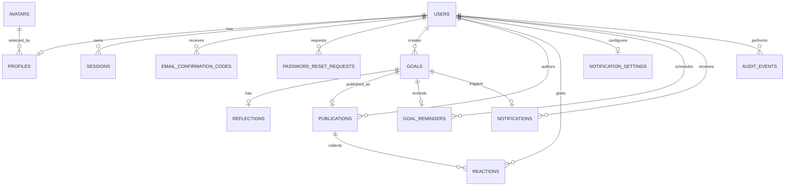

# Схема базы данных

- **Статус:** принято
- **Задача:** [#3 «Спроектировать схему базы данных»](https://github.com/trkpo/goals_app_backend/issues/3)
- **Связанные документы:** [`docs/API.md`](../API.md), [`docs/adr/0001-api-contract-decisions.md`](../adr/0001-api-contract-decisions.md), HLD (разделы 5–7 и приложение А)
- **Миграции:** `src/main/resources/db/migration/V2__identity_and_profiles.sql`, `V3__goals_and_reflections.sql`, `V4__feed.sql`, `V5__notifications_and_audit.sql`

## 1. Общие принципы

- Одна общая база данных PostgreSQL для всех домен-сервисов. Схемы разделены по владельцам: `identity`, `profiles`, `goals`, `feed`, `notifications`, `audit`.
- Сервис пишет только в свои таблицы. Внешние ключи между схемами разрешены: это позволяет выполнить итог, публикацию и реакции одной транзакцией (HLD 3.2, 7.2).
- Первичные ключи — `uuid` с `gen_random_uuid()` (расширение `pgcrypto` подключено в `V1__baseline.sql`).
- Все моменты времени — `timestamptz`; приложение хранит и отдаёт UTC.
- У изменяемых записей есть `version bigint` и `updated_at timestamptz`. Увеличение версии и изменение записи выполняются в одной транзакции (ADR 0001, п. 2).
- Неизменяемые записи (`goals.reflections`, `audit.events`) не имеют `version`; `audit.events` защищена триггером от `UPDATE` и `DELETE`.
- Удаление учётной записи, цели и публикации выполняется каскадом по внешним ключам (NF_Data_1, F_Goal_7, F_Feed_10).

## 2. ERD

Схемы на диаграмме не показаны; соответствие таблиц схемам — в разделах ниже.

## 3. Домен identity

Владелец: сервис `identity`. Таблицы учётных записей, кодов и сеансов.

### `identity.users`

| Поле | Тип | Ограничения |
|------|-----|-------------|
| `id` | `uuid` | PK, `gen_random_uuid()` |
| `email` | `varchar(254)` | NOT NULL, непустой |
| `password_hash` | `varchar(255)` | NOT NULL, bcrypt |
| `email_confirmed_at` | `timestamptz` | NULL до подтверждения (F_Auth_9, F_Auth_18) |
| `created_at` | `timestamptz` | NOT NULL, `now()` |
| `updated_at` | `timestamptz` | NOT NULL, `now()` |
| `version` | `bigint` | NOT NULL, `0` |
| `deleted_at` | `timestamptz` | NULL; мягкое удаление до очистки (F_Prof_6) |

Индексы:

- `users_email_active_ux` — уникальный `lower(email)` при `deleted_at IS NULL`: адрес уникален среди неудалённых учётных записей (F_Auth_8).
- `users_deleted_at_idx` — частичный индекс для задания очистки.

### `identity.email_confirmation_codes`

| Поле | Тип | Ограничения |
|------|-----|-------------|
| `id` | `uuid` | PK |
| `user_id` | `uuid` | FK → `identity.users`, `ON DELETE CASCADE` |
| `code_hash` | `varchar(255)` | NOT NULL; хранится хеш, не код |
| `expires_at` | `timestamptz` | NOT NULL, позже `created_at` (10 минут) |
| `consumed_at` | `timestamptz` | NULL, пока код активен |
| `created_at` | `timestamptz` | NOT NULL |

Индексы: `(user_id, created_at DESC)`; частичный уникальный `(user_id)` при `consumed_at IS NULL` — у пользователя один активный код (F_Auth_15).

### `identity.password_reset_requests`

| Поле | Тип | Ограничения |
|------|-----|-------------|
| `id` | `uuid` | PK |
| `user_id` | `uuid` | FK → `identity.users`, `ON DELETE CASCADE` |
| `code_hash` | `varchar(255)` | NOT NULL |
| `reset_token_hash` | `varchar(255)` | NULL до успешной проверки кода |
| `expires_at` | `timestamptz` | NOT NULL, срок кода |
| `reset_token_expires_at` | `timestamptz` | NULL; заполняется вместе с токеном |
| `consumed_at` | `timestamptz` | NULL, пока запрос активен |
| `created_at` | `timestamptz` | NOT NULL |

Индексы: `(user_id, created_at DESC)`; частичный уникальный `(user_id)` при `consumed_at IS NULL`. Пара `reset_token_hash` и `reset_token_expires_at` заполняется одновременно (CHECK).

### `identity.sessions`

| Поле | Тип | Ограничения |
|------|-----|-------------|
| `id` | `uuid` | PK |
| `user_id` | `uuid` | FK → `identity.users`, `ON DELETE CASCADE` |
| `refresh_token_hash` | `varchar(255)` | NOT NULL, уникальный |
| `issued_at` | `timestamptz` | NOT NULL |
| `expires_at` | `timestamptz` | NOT NULL, позже `issued_at` |
| `revoked_at` | `timestamptz` | NULL |
| `replaced_by_id` | `uuid` | FK → `identity.sessions`, `ON DELETE SET NULL` |
| `created_at` | `timestamptz` | NOT NULL |
| `updated_at` | `timestamptz` | NOT NULL |

Индексы: уникальный `refresh_token_hash`; `(user_id, expires_at DESC)`; частичный `(revoked_at)` для отозванных сеансов. Ротация refresh-токена связывает новую запись через `replaced_by_id` (NF_Sec_4).

## 4. Домен profiles

Владелец: сервис `profiles`.

### `profiles.avatars`

| Поле | Тип | Ограничения |
|------|-----|-------------|
| `avatar_id` | `varchar(64)` | PK |
| `url` | `text` | NOT NULL, непустой |
| `content_type` | `varchar(128)` | NOT NULL |
| `image_data` | `bytea` | NOT NULL; отдельного файлового хранилища нет (HLD 3.2) |
| `version` | `bigint` | NOT NULL; используется для кэширования набора |
| `created_at` | `timestamptz` | NOT NULL |
| `updated_at` | `timestamptz` | NOT NULL |

### `profiles.profiles`

| Поле | Тип | Ограничения |
|------|-----|-------------|
| `user_id` | `uuid` | PK, FK → `identity.users`, `ON DELETE CASCADE` |
| `nickname` | `varchar(30)` | NOT NULL, 2–30 символов (F_Prof_1) |
| `avatar_id` | `varchar(64)` | FK → `profiles.avatars`, `ON DELETE SET NULL` |
| `goals_created` | `integer` | NOT NULL, `0`, ≥ 0 |
| `results_published` | `integer` | NOT NULL, `0`, ≥ 0 |
| `completed_goals` | `integer` | NOT NULL, `0`, ≥ 0 |
| `self_score_total` | `integer` | NOT NULL, `0`, от 0 до `completed_goals * 10` |
| `version` | `bigint` | NOT NULL |
| `created_at` | `timestamptz` | NOT NULL |
| `updated_at` | `timestamptz` | NOT NULL |

`average_self_score` не хранится отдельно: это `self_score_total / completed_goals`, округлённое до одного знака; при `completed_goals = 0` отдаётся `0.0` (F_Prof_8). Счётчики обновляются в той же транзакции, что и сохранение итога (API `profiles.me.get`).

Индексы: `lower(nickname)` для поиска и сортировки; `avatar_id` для выбора по аватару.

## 5. Домен goals

Владелец: сервис `goals`. Ожидаемый результат — поле цели, отдельной сущности нет (HLD 7.1).

### `goals.goals`

| Поле | Тип | Ограничения |
|------|-----|-------------|
| `id` | `uuid` | PK |
| `user_id` | `uuid` | FK → `identity.users`, `ON DELETE CASCADE` |
| `title` | `varchar(100)` | NOT NULL, 3–100 символов (F_Goal_1) |
| `goal_text` | `text` | NOT NULL, 1–5000 символов (F_Goal_2) |
| `path_text` | `text` | NOT NULL, 1–5000 символов, Markdown (F_Goal_3) |
| `expected_result` | `varchar(500)` | NOT NULL, 1–500 символов (F_Goal_15) |
| `status` | `goals.goal_status` | NOT NULL, `draft` по умолчанию (F_Goal_4) |
| `planned_end_at` | `timestamptz` | NOT NULL (F_Goal_14) |
| `completed_at` | `timestamptz` | NULL; заполнен тогда и только тогда, когда `status = completed` |
| `created_at` | `timestamptz` | NOT NULL |
| `updated_at` | `timestamptz` | NOT NULL |
| `version` | `bigint` | NOT NULL; ключ `ETag`/`If-Match` (ADR 0001) |

Перечисление `goals.goal_status`: `draft`, `active`, `completed`.

Индексы:

- `goals_user_created_idx` — `(user_id, created_at DESC, id DESC)` для «Мои цели» и курсорной пагинации (F_Goal_8, F_Goal_9).
- `goals_user_status_created_idx` — `(user_id, status, created_at DESC, id DESC)` для фильтра по статусу (F_Goal_10).
- `goals_status_planned_end_idx` — `(status, planned_end_at)` для заданий напоминаний и завершения по дате.

### `goals.reflections`

| Поле | Тип | Ограничения |
|------|-----|-------------|
| `id` | `uuid` | PK |
| `goal_id` | `uuid` | FK → `goals.goals`, `ON DELETE CASCADE`, уникальный |
| `result` | `goals.reflection_result` | NOT NULL |
| `fact_text` | `varchar(3000)` | NULL только при `result = came_true` (F_Ref_2) |
| `self_score` | `smallint` | NOT NULL, 1–10 (F_Ref_3) |
| `reflected_at` | `timestamptz` | NOT NULL |
| `created_at` | `timestamptz` | NOT NULL |

Перечисление `goals.reflection_result`: `came_true`, `partially`, `failed`.

Уникальность `goal_id` задаёт правило «один итог на цель» (F_Ref_5, HLD 7.2). Индекс `(result, reflected_at DESC, id DESC)` обслуживает фильтр ленты по типу итога.

## 6. Домен feed

Владелец: сервис `feed`. Готовые страницы ленты и окно популярности — производное хранилище (ScyllaDB), в PostgreSQL хранится истина: публикации и реакции.

### `feed.publications`

| Поле | Тип | Ограничения |
|------|-----|-------------|
| `id` | `uuid` | PK |
| `goal_id` | `uuid` | FK → `goals.goals`, `ON DELETE CASCADE`, уникальный |
| `author_id` | `uuid` | FK → `identity.users`, `ON DELETE CASCADE` |
| `visibility` | `feed.publication_visibility` | NOT NULL, `visible` по умолчанию |
| `published_at` | `timestamptz` | NOT NULL |
| `created_at` | `timestamptz` | NOT NULL |
| `updated_at` | `timestamptz` | NOT NULL |
| `version` | `bigint` | NOT NULL; увеличивается при смене видимости и реакций |

Перечисление `feed.publication_visibility`: `visible`, `hidden`.

Уникальность `goal_id` запрещает вторую публикацию по цели (API `feed.publications.create`, `409 ALREADY_PUBLISHED`); повторный показ выполняется сменой `visibility` (F_Feed_8). Публикация только для завершённой цели проверяется сервисом: межтабличное условие по статусу нельзя выразить декларативно (HLD 7.2).

Индексы: `(visibility, published_at DESC, id DESC)` для сортировок «новые»/«старые»; `(author_id, created_at DESC, id DESC)` для публикаций автора.

### `feed.reactions`

| Поле | Тип | Ограничения |
|------|-----|-------------|
| `publication_id` | `uuid` | FK → `feed.publications`, `ON DELETE CASCADE` |
| `user_id` | `uuid` | FK → `identity.users`, `ON DELETE CASCADE` |
| `reaction` | `feed.reaction_type` | NOT NULL |
| `created_at` | `timestamptz` | NOT NULL |
| `updated_at` | `timestamptz` | NOT NULL |

Первичный ключ `(publication_id, user_id)` задаёт «одна реакция пользователя на публикацию» (F_Feed_6, HLD 7.2). Перечисление `feed.reaction_type`: `support`, `energy`.

Счётчики по типам не хранятся в истине: они считаются `GROUP BY reaction` и попадают в карточку производного хранилища; `reactions_total` — сумма типов (ADR 0001, п. 3). Запрет реакции на свою публикацию проверяется сервисом.

Индексы: `(publication_id, reaction)` для счётчиков; `(user_id)` для каскадов и выборок по пользователю.

## 7. Домен notifications

Владелец: сервис `notifications`.

### `notifications.settings`

| Поле | Тип | Ограничения |
|------|-----|-------------|
| `user_id` | `uuid` | PK, FK → `identity.users`, `ON DELETE CASCADE` |
| `email_duplicate_enabled` | `boolean` | NOT NULL, `false` по умолчанию (F_Rem_4) |
| `default_remind_after_days` | `smallint` | NOT NULL, `1`, 1–365 (F_Rem_1) |
| `version` | `bigint` | NOT NULL |
| `created_at` | `timestamptz` | NOT NULL |
| `updated_at` | `timestamptz` | NOT NULL |

### `notifications.reminders`

| Поле | Тип | Ограничения |
|------|-----|-------------|
| `id` | `uuid` | PK |
| `goal_id` | `uuid` | FK → `goals.goals`, `ON DELETE CASCADE`, уникальный |
| `user_id` | `uuid` | FK → `identity.users`, `ON DELETE CASCADE` |
| `enabled` | `boolean` | NOT NULL, `true` по умолчанию (F_Rem_2) |
| `remind_after_days` | `smallint` | NULL — используется значение из настроек; иначе 1–365 |
| `scheduled_at` | `timestamptz` | NULL; рассчитывается при переводе цели в `active` (F_Rem_7) |
| `version` | `bigint` | NOT NULL |
| `created_at` | `timestamptz` | NOT NULL |
| `updated_at` | `timestamptz` | NOT NULL |

Индексы: частичный `(scheduled_at)` при `enabled AND scheduled_at IS NOT NULL` для поиска наступивших напоминаний; `(user_id, goal_id)`.

### `notifications.notifications`

| Поле | Тип | Ограничения |
|------|-----|-------------|
| `id` | `uuid` | PK |
| `goal_id` | `uuid` | FK → `goals.goals`, `ON DELETE CASCADE`, уникальный |
| `user_id` | `uuid` | FK → `identity.users`, `ON DELETE CASCADE` |
| `scheduled_at` | `timestamptz` | NOT NULL |
| `delivered_at` | `timestamptz` | NULL, пока уведомление не доставлено |
| `email_status` | `notifications.email_delivery_status` | NOT NULL, `not_requested` |
| `version` | `bigint` | NOT NULL |
| `created_at` | `timestamptz` | NOT NULL |
| `updated_at` | `timestamptz` | NOT NULL |

Перечисление `notifications.email_delivery_status`: `not_requested`, `sent`, `failed`.

Уникальность `goal_id` обеспечивает однократное срабатывание напоминания (F_Rem_9). Индексы: `(user_id, scheduled_at DESC, id DESC)` и `(user_id, delivered_at DESC, id DESC)` для `notifications.list`.

## 8. Домен audit

Владелец: сервис `audit`. Журнал только дополняется (NF_Obs_1); `user_id` не связан внешним ключом, чтобы записи переживали удаление учётной записи.

### `audit.events`

| Поле | Тип | Ограничения |
|------|-----|-------------|
| `id` | `uuid` | PK |
| `entity_type` | `audit.entity_type` | NOT NULL: `goal`, `post`, `profile`, `session` |
| `entity_id` | `uuid` | NOT NULL |
| `operation` | `audit.operation_type` | NOT NULL: `create`, `update`, `delete` |
| `user_id` | `uuid` | NULL, без FK |
| `occurred_at` | `timestamptz` | NOT NULL |
| `payload` | `jsonb` | NOT NULL, `{}` по умолчанию |

Индексы: `(occurred_at DESC, id DESC)`, `(user_id, occurred_at DESC, id DESC)`, `(entity_type, entity_id, occurred_at DESC, id DESC)` под `audit.events.list`. Триггер `audit_events_append_only` отклоняет `UPDATE` и `DELETE`.

## 9. Каскады

| Удаляется | Каскадно удаляется |
|-----------|--------------------|
| `identity.users` | профиль, цели, итоги, публикации, реакции, напоминания, уведомления, сеансы, коды, настройки напоминаний |
| `goals.goals` | итог, публикация, реакции публикации, напоминание, уведомление |
| `feed.publications` | реакции |
| `profiles.avatars` | `avatar_id` в профилях становится `NULL` |
| `audit.events` | не удаляется; `user_id` хранится без FK |

Удаление учётной записи выполняется одной транзакцией (NF_Data_1). Строки производной ленты снимает задание очистки в течение 24 часов.

## 10. Версии, `updated_at` и конкурентные правки

| Таблица | `version` | `updated_at` |
|---------|-----------|--------------|
| `identity.users` | да | да |
| `identity.sessions` | нет | да |
| `identity.email_confirmation_codes` | нет | нет |
| `identity.password_reset_requests` | нет | нет |
| `profiles.avatars` | да | да |
| `profiles.profiles` | да | да |
| `goals.goals` | да | да |
| `goals.reflections` | нет | нет |
| `feed.publications` | да | да |
| `feed.reactions` | нет | да |
| `notifications.settings` | да | да |
| `notifications.reminders` | да | да |
| `notifications.notifications` | да | да |
| `audit.events` | нет | нет |

`version` увеличивается приложением в той же транзакции, что и изменение записи; для цели и профиля значение отдаётся как `ETag`, проверяется через `If-Match` (ADR 0001). `updated_at` обновляется приложением (JPA `@LastModifiedDate`).

## 11. Курсорная пагинация

Курсор — `base64url` от ключа сортировки и `id` последней строки; ключ всегда дополняется `id`, чтобы вставки не давали дублей и пропусков (ADR 0001, п. 6).

| Запрос | Ключ сортировки | Индекс |
|--------|-----------------|--------|
| `goals.list` | `(created_at, id)` | `goals_user_created_idx`, `goals_user_status_created_idx` |
| `feed.list` (newest/oldest) | `(published_at, publication_id)` | `publications_visibility_published_idx` |
| `notifications.list` | `(scheduled_at, id)` | `notifications_user_scheduled_idx` |
| `audit.events.list` | `(occurred_at, id)` | `audit_events_*_idx` |

Сортировка `popular` и фильтр `result` работают по производному хранилищу ленты и не меняют индексы общей базы (ADR 0001, п. 4).

## 12. Производные данные и идемпотентность

- Готовые страницы ленты, окно популярности и прогресс переноса хранятся в ScyllaDB (HLD 7.3). В PostgreSQL остаются только истинные публикации, реакции и `version`, по которому задание проекции выбирает изменения.
- `Idempotency-Key` и результат запроса хранятся 24 часа в Redis (область «пользователь + метод + путь»); отдельной таблицы в общей базе нет (ADR 0001, п. 7).
- Ограничение частоты и отзыв сеансов также используют Redis; в базе хранятся только сами сеансы.

## 13. Соответствие API

| Эндпоинт | Таблицы |
|----------|---------|
| `identity.auth.register`, `identity.email.confirm*` | `identity.users`, `identity.email_confirmation_codes` |
| `identity.auth.login`, `refresh`, выход | `identity.users`, `identity.sessions` |
| `identity.password.*` | `identity.password_reset_requests`, `identity.users` |
| `identity.users.me` | `identity.users` |
| `profiles.*` | `profiles.profiles`, `profiles.avatars`, `identity.users` |
| `goals.create`, `list`, `get`, `update`, `status.update`, `delete` | `goals.goals`, `goals.reflections` |
| `feed.publications.*` | `feed.publications`, `goals.goals`, `goals.reflections` |
| `feed.reactions.*` | `feed.reactions`, `feed.publications` |
| `feed.list` | `feed.publications`, `feed.reactions` (истина), производное хранилище (чтение) |
| `notifications.settings.*` | `notifications.settings` |
| `notifications.activity.set` | `notifications.reminders` |
| `notifications.list` | `notifications.notifications` |
| `audit.events.list` | `audit.events` |

## 14. Чек-лист задачи #3

- [x] Описаны таблицы и связи всех доменов `identity`, `profiles`, `goals`, `feed`, `notifications`, `audit`.
- [x] Есть поля версии и времени обновления записей.
- [x] Настроены каскады при удалении профиля, цели и публикации.
- [x] Добавлены индексы под фильтры, сортировки и курсор.
- [x] Схема соответствует контрактам `docs/API.md`.
